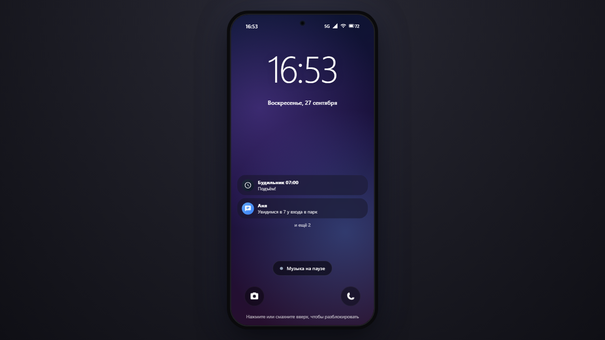
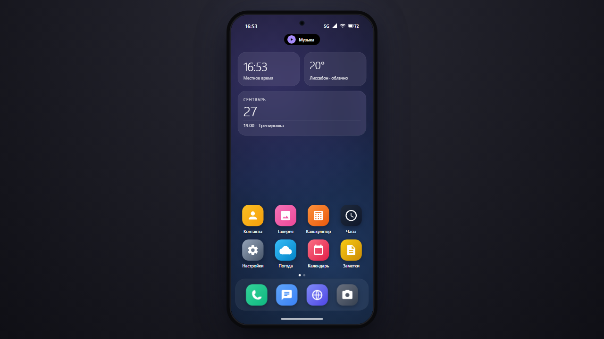
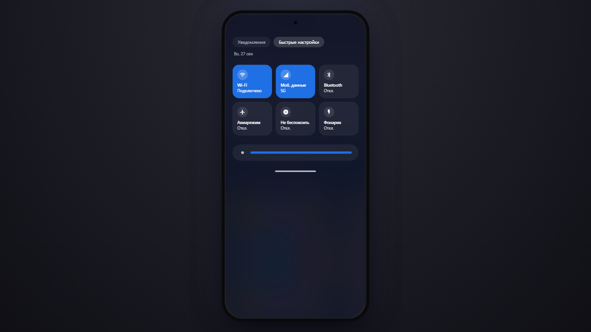

<div align="center">

# AndroidDemo - the "Wave" phone

**The "Wave" phone («Волна») is an Android phone in the spirit of One UI 7 that runs entirely in the browser: lock screen, home screen, notification shade with quick settings, recent apps and working apps. No server, no internet, no images or fonts from the original system.**

[**▶ Open online →**](https://alexalesha.github.io/AndroidDemo/) &nbsp;·&nbsp; [Русская версия этого файла](README.ru.md)

[](#) [](https://github.com/ALEXalesha/AndroidDemo/actions/workflows/ci.yml) [](LICENSE) [](https://developer.mozilla.org/docs/Web/HTML) [](https://alexalesha.github.io/AndroidDemo/) [](https://claude.com/claude-code)

Code, tests and docs are written by Claude (Anthropic) in Claude Code. Ideas, testing and decisions - Alexey.

</div>

> Fan-made interface concept. Not affiliated with or endorsed by Samsung or Google. One UI is a trademark of Samsung Electronics; Android is a trademark of Google LLC.

The interface is in Russian.







## What it does

- Notification shade with quick settings and brightness, pop-up notifications that open their app, recent apps (swipe up and hold, or long press on the bar) with "Close all".
- Apps: Phone (call screen with a timer and call log), Messages, Contacts, Mail, Internet (built-in pages), Gallery (camera shots and pictures from files), Camera, Calculator, Clock (world clock, alarms, timer, stopwatch), Calendar, Notes, Music (synthesised melodies), Weather, Settings and My Files (IndexedDB).
- Settings, wallpaper, notes, alarms, events, chats, photos, the call log and read mail are saved; apps in the background are paused.
- **Games:** the ten games of the [Hub](https://github.com/ALEXalesha/ALEXalesha.github.io) collection
  open in a window: Cube World, Blockcity, Operation: Perimeter, Horizon Drift, Dino Run, Jump Jump,
  Hot Jungle, Space Gun, Falling Blocks and Sudoku. Each is its own repository: on GitHub Pages the
  window loads `../../<repository>/` of the same site (for example
  [AlexMine](https://alexalesha.github.io/AlexMine/)). Locally, clone the game repositories next to
  this one. A game in a minimised or inactive window is paused (the protocol is in
  `_os-shared/README.md`).


The phone lives in `oneui7/`; it is built from `oneui7/src/` by `node oneui7/src/build.js`. The root `index.html` just opens it.


## Run locally

Open `index.html` or `oneui7/index.html` in Chrome or Edge.

## Tests

Playwright laws in `tests/` open the page by its file address in headless Chromium, one at a
time:

```
npm install
npx playwright install chromium
npm test
```

The tests for game windows run only when the game repositories lie next to this one; otherwise
they are skipped. Mouse capture in the tests is always a stub. The pictures above were made headless by the screenshot script of the Hub collection.

## History

The phone was made in the [Hub](https://github.com/ALEXalesha/ALEXalesha.github.io) collection (folders `web/oneui7` and `web/_os-shared`), where it also opens from the Hub. This repository carries it with its commit history, starting after the first raw import (it still had other companies' brand names); the start page, the games table for the separately published games and the tests were added for this publication.

## Licence

MIT, see [LICENSE](LICENSE).
